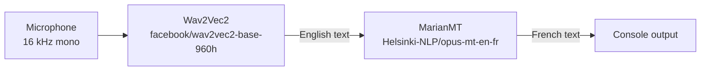

# Frenglish: English Speech to French Text

Speak English into a microphone and get French text back. This repo holds the speech-to-text and translation pipeline from my undergraduate capstone thesis at Al Akhawayn University (Fall 2023, supervised by Dr. Tajjeeddine Rachidi).

Abstract accepted for presentation at BrainWeek: AI & Telehealth Conference (2023).

## The problem

There are two common ways to turn English speech into French text:

- **Cascaded:** transcribe the English speech to English text, then translate the text.
- **Direct:** translate the speech to French speech, then transcribe the French audio.

The thesis compared the two on translation quality and robustness to accents, speaking speed and background noise, to decide which one a mobile app should use. The cascaded pipeline won, and it's the one implemented here.

## How it works



| Step | Model | Code |
|---|---|---|
| Speech to English text | [`facebook/wav2vec2-base-960h`](https://huggingface.co/facebook/wav2vec2-base-960h) | `src/speech_recognition_model.py` |
| English to French text | [`Helsinki-NLP/opus-mt-en-fr`](https://huggingface.co/Helsinki-NLP/opus-mt-en-fr) | `src/machine_translation.py` |
| The two steps chained | | `src/pipeline.py` |

Models download from Hugging Face on first use and are loaded once per run.

## Run it

```bash
pip install -r requirements.txt
python main.py                 # records 10 seconds
python main.py --duration 5    # records 5 seconds
```

You need a working microphone. The first run downloads both models, so it needs an internet connection.

To use the pipeline from your own code with 16 kHz audio:

```python
from src.pipeline import speech_to_french

result = speech_to_french(audio)   # 1-D float array, 16 kHz
print(result["transcription"], result["translation"])
```

## Tests

```bash
python -m unittest discover -s tests -t . -v
```

The tests mock both models, so they check the pipeline's wiring and input handling, not translation quality.

## Thesis results (2023)

These are the results reported in the thesis. The evaluation code isn't in this repo yet, so they can't be reproduced from it.

The evaluation used 7 datasets: LibriSpeech, CommonVoice, VoxCeleb, Europarl, Common Crawl, OpenSubtitles and VoxForge. Robustness was measured across accent variation, speech-rate variation and noise.

| Component | Metric | Result |
|---|---|---|
| Wav2Vec2 (transcription) | Word error rate | 3.2% (standard English) to 6.5% (noisy) |
| | Robustness | 92.8% |
| MarianMT (cascaded translation) | BLEU | 79.5–85.2 |
| | Robustness | 88.6% |
| | Human-rated naturalness | 4.3 / 5 |
| OpusMT (direct translation) | BLEU | 76.2–82.5 |
| | Robustness | 87.9% |
| | Human-rated naturalness | 3.9 / 5 |

The cascaded pipeline scored higher on BLEU, robustness and naturalness, and was simpler to build, so it was selected.

TODO (Ranya): the thesis also included a Flask backend and a React Native + Expo mobile app. Add them here, or remove this line once decided.

## Limitations

- **Recorded clips, not streaming.** The program records a fixed-length clip and then processes it; it doesn't translate while you speak.
- **English to French only.** Both models are fixed to this language pair.
- **Wav2Vec2 has no punctuation or casing**, so the translator receives unpunctuated lowercase text, which can hurt translation of longer sentences.
- **Long clips:** inputs past the translator's maximum length are truncated.
- `wav2vec2-base-960h` was trained on read audiobook speech (LibriSpeech), so accuracy drops on accented, fast or noisy speech, as the thesis robustness numbers show.
