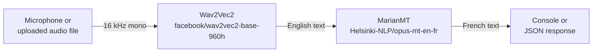

# Frenglish: English Speech to French Text

[](https://github.com/RanyaRhazi/CapstoneProject/actions/workflows/ci.yml)

Speak English into a microphone and get French text back. This repo holds the speech-to-text and translation pipeline from my undergraduate capstone thesis at Al Akhawayn University (Fall 2023, supervised by Dr. Tajjeeddine Rachidi).

Abstract accepted for presentation at BrainWeek: AI & Telehealth Conference (2023).

## The problem

There are two common ways to turn English speech into French text:

- **Cascaded:** transcribe the English speech to English text, then translate the text.
- **Direct:** translate the speech to French speech, then transcribe the French audio.

The thesis compared the two on translation quality and robustness to accents, speaking speed and background noise, to decide which one a mobile app should use. The cascaded pipeline won, and it's the one implemented here.

## How it works



| Step | Model | Code |
|---|---|---|
| Speech to English text | [`facebook/wav2vec2-base-960h`](https://huggingface.co/facebook/wav2vec2-base-960h) | `src/speech_recognition_model.py` |
| English to French text | [`Helsinki-NLP/opus-mt-en-fr`](https://huggingface.co/Helsinki-NLP/opus-mt-en-fr) | `src/machine_translation.py` |
| The two steps chained | | `src/pipeline.py` |
| HTTP API | | `app.py` |

Models download from Hugging Face on first use and are loaded once per run.

## Run it

```bash
pip install -r requirements.txt
```

The first run downloads both models, so it needs an internet connection.

### From the microphone

```bash
python main.py                 # records 10 seconds
python main.py --duration 5    # records 5 seconds
```

### As an API

```bash
python app.py                  # http://localhost:5000
curl -F "audio=@clip.wav" http://localhost:5000/translate
```

`POST /translate` takes a WAV, FLAC or OGG file in a multipart field named `audio`, at any sample rate (it's converted to 16 kHz mono), and returns:

```json
{"transcription": "nor is mister quilter's manner less interesting than his matter",
 "translation": "ni la manière de monsieur Quilter n'est pas moins intéressante que sa matière."}
```

That example is real output from the CI smoke test on a LibriSpeech clip. Bad or missing files get HTTP 400; uploads over 20 MB get HTTP 413. `GET /health` returns `{"status": "ok"}`.

### From Python

```python
from src.pipeline import speech_to_french

result = speech_to_french(audio)   # 1-D float array, 16 kHz
print(result["transcription"], result["translation"])
```

## Tests

```bash
python -m unittest discover -s tests -t . -v
```

The unit tests mock both models, so they check the pipeline, API and audio handling, not translation quality. CI also runs [`scripts/smoke_test.py`](scripts/smoke_test.py), which runs both real models on LibriSpeech clips and fails if the word error rate goes above 25%.

## Evaluation (reproduction)

[`eval/run_eval.py`](eval/run_eval.py) measures the cascaded pipeline on public test sets:

- **Transcription:** WER and CER on LibriSpeech test-clean, on clean audio, with added white noise at 20, 10 and 5 dB SNR, and sped up or slowed down by 10%.
- **Translation:** BLEU and chrF ([sacreBLEU](https://github.com/mjpost/sacrebleu)) on WMT14 newstest2014 English-to-French.

```bash
pip install -r requirements.txt -r eval/requirements.txt
python eval/run_eval.py --asr-n 200 --mt-n 500
```

It also runs in GitHub Actions ([Evaluate workflow](.github/workflows/evaluate.yml)) and writes `eval/results.json`.

### Results

From [this GitHub Actions run](https://github.com/RanyaRhazi/CapstoneProject/actions/runs/39996001350), CPU only; raw output in [`eval/results.json`](eval/results.json).

**Transcription (Wav2Vec2)** on the first 200 utterances of LibriSpeech test-clean (26 minutes of audio):

| Condition | WER | CER |
|---|---|---|
| Clean | 2.8% | 0.9% |
| White noise, 20 dB SNR | 3.5% | 1.2% |
| White noise, 10 dB SNR | 14.4% | 6.0% |
| White noise, 5 dB SNR | 56.5% | 30.7% |
| Speed 0.9x | 2.8% | 1.0% |
| Speed 1.1x | 2.8% | 0.9% |

Accuracy barely changes at 20 dB SNR or with 10% speed changes, rises to 14% WER at 10 dB, and breaks down at 5 dB, where more than half the words are wrong. For reference, the model card reports 3.4% WER on the full test-clean set.

**Translation (MarianMT)** on the first 500 sentences of WMT14 newstest2014 English-to-French:

| Metric | Score |
|---|---|
| BLEU | 40.5 |
| chrF | 64.6 |

These test sets differ from the thesis's, so the two sets of numbers aren't directly comparable.

## Thesis results (2023)

These are the results reported in the thesis. The thesis evaluation code isn't in this repo, so these numbers can't be reproduced from it; the reproduction above uses different test sets.

The evaluation used 7 datasets: LibriSpeech, CommonVoice, VoxCeleb, Europarl, Common Crawl, OpenSubtitles and VoxForge. Robustness was measured across accent variation, speech-rate variation and noise.

| Component | Metric | Result |
|---|---|---|
| Wav2Vec2 (transcription) | Word error rate | 3.2% (standard English) to 6.5% (noisy) |
| | Robustness | 92.8% |
| MarianMT (cascaded translation) | BLEU | 79.5–85.2 |
| | Robustness | 88.6% |
| | Human-rated naturalness | 4.3 / 5 |
| OpusMT (direct translation) | BLEU | 76.2–82.5 |
| | Robustness | 87.9% |
| | Human-rated naturalness | 3.9 / 5 |

The cascaded pipeline scored higher on BLEU, robustness and naturalness, and was simpler to build, so it was selected.

## Limitations

- **Recorded clips, not streaming.** The program records or receives a whole clip and then processes it; it doesn't translate while you speak.
- **The thesis's direct pipeline (OpusMT speech-to-speech) isn't implemented here**, only the cascaded one it selected.
- **English to French only.** Both models are fixed to this language pair.
- **Wav2Vec2 has no punctuation or casing**, so the translator receives unpunctuated lowercase text, which can hurt translation of longer sentences.
- **Long clips:** inputs past the translator's maximum length are truncated.
- `wav2vec2-base-960h` was trained on read audiobook speech (LibriSpeech), so accuracy drops on accented, fast or noisy speech, as the thesis robustness numbers show.
